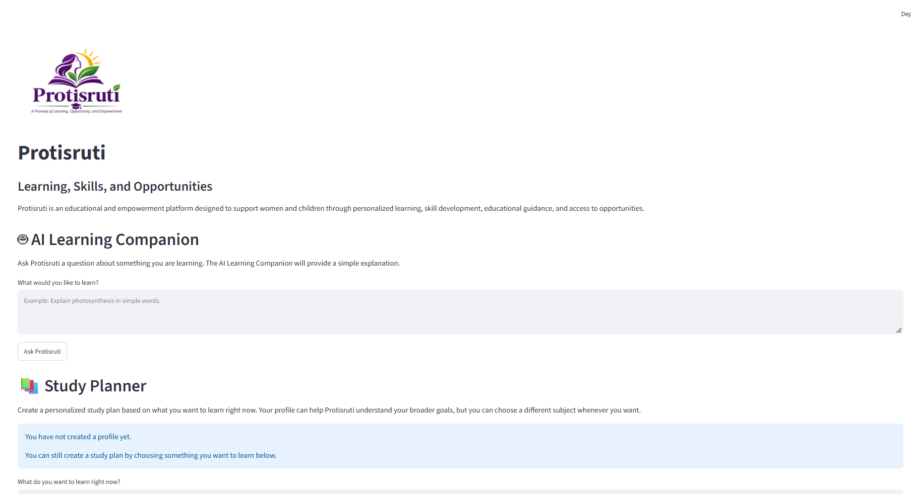

# Protisruti


### A Promise of Learning, Opportunity, and Empowerment

Protisruti is an educational and empowerment platform designed to support women and children through accessible learning assistance, skill development, educational guidance, and opportunities.

The platform brings together a Learning Companion, personalized study planning, quizzes, educational resources, user profiles, learning recommendations, and progress tracking.

Protisruti aims to make learning more accessible and help users take meaningful steps toward their educational and personal goals.

> Protisruti is currently a functional prototype under active development.

---

## Vision

Protisruti aims to make educational guidance and learning support more accessible to women and children, particularly those who may have limited access to personalized tutoring, mentoring, educational resources, or career guidance.

The platform aims to help users:

- Learn new skills
- Set educational goals
- Practice what they learn
- Discover educational and career opportunities
- Track their learning progress
- Build confidence through continuous learning

---

## The Problem

Many women and children face barriers to education and personal development, including:

- Limited access to personalized educational support
- Lack of affordable tutoring or mentoring
- Difficulty finding suitable learning resources
- Limited information about scholarships and opportunities
- Limited access to digital-skills training
- Difficulty creating structured learning plans
- Difficulty tracking learning progress

Protisruti explores how technology can help address some of these challenges through an accessible educational platform.

---

## Application Preview



Protisruti provides an interactive learning environment where users can create profiles, receive educational assistance, generate study plans, practice through quizzes, access resources, and track their learning progress.

---

## Features

### 1. AI Learning Companion

The Learning Companion allows users to ask educational questions and receive simple explanations.

Current functionality uses locally defined educational responses for supported topics, including:

- Python
- Artificial Intelligence
- Machine Learning
- Data Science
- Statistics
- Mathematics
- Computer fundamentals
- Photosynthesis

The feature also provides learning suggestions and can incorporate information from a user's profile.

External AI model integration is planned for a future version.

### 2. Personalized Study Planner

Users can create study plans based on:

- Learning goals
- Current skill level
- Available study time
- Study duration

The planner helps users organize their learning into a structured plan.

### 3. Quiz Generator

Users can generate and complete practice quizzes based on:

- Subject
- Topic
- Difficulty level
- Number of questions

Current subjects include:

- Python
- Mathematics
- English

Quiz functionality includes:

- Multiple-choice questions
- Automatic scoring
- Percentage calculations
- Correct and incorrect answer feedback
- Answer explanations
- Quiz result storage

### 4. User Profiles

Users can create and load profiles containing:

- Name
- Age group
- User type
- Education level
- Learning interests
- Main learning goal

Profile information supports personalized learning suggestions and recommendations.

### 5. Learning Progress Tracker

Users can review their completed quizzes and learning performance.

Current functionality includes:

- Number of quizzes completed
- Overall scores
- Individual quiz results
- Quiz subjects and topics
- Percentage scores
- Quiz completion dates

### 6. Resource Center

The Resource Center organizes educational and opportunity-related resources into categories:

- Women's Education
- Children's Learning
- Skills & Career
- Scholarships & Opportunities
- Safety & Well-being

Resources can include a title, description, and resource type.

### 7. Personalized Recommendations

Protisruti includes a recommendation component that uses profile information and learning progress to suggest relevant learning activities.

Recommendations can consider:

- Learning goals
- Personal interests
- Skill development needs
- Recent quiz performance

### 8. SQLite Database

Protisruti uses SQLite for local data storage.

The database supports application information such as:

- User profiles
- Learning goals
- Quiz results
- Scores
- Quiz completion dates

The database is initialized automatically by the application.

---

## Women and Girls

Protisruti aims to support women and girls who want to:

- Develop digital skills
- Learn programming
- Improve English and communication skills
- Explore educational pathways
- Discover scholarships
- Explore career opportunities
- Find educational resources
- Create structured learning plans

---

## Children and Students

The platform also aims to support children and students through:

- Educational questions and explanations
- Academic practice
- Quizzes
- Study planning
- Educational resources
- Learning progress tracking

Additional privacy, safeguarding, and age-appropriate design measures will be necessary before real-world deployment involving minors.

---

## Technology Stack

| Technology | Purpose |
|---|---|
| Python | Application development |
| Streamlit | Web application interface |
| SQLite | Local database |
| Git | Version control |
| GitHub | Source code management |
| Pytest | Automated testing |

The current Learning Companion uses local response logic. External AI API integration is a planned enhancement, not an implemented feature.

---

## 📁 Project Structure

```text
Protisruti/
│
├── app/
│   ├── main.py
│   ├── ai_assistant.py
│   ├── ai_config.py
│   ├── quiz_generator.py
│   ├── recommendations.py
│   ├── resources.py
│   ├── study_planner.py
│   └── user_profile.py
│
├── assets/
│   └── Protisruti_logo.png
│
├── database/
│   └── database.py
│
├── data/
│
├── screenshots/
│   └── protisruti-dashboard.png
│
├── tests/
│   ├── test_ai_assistant.py
│   ├── test_database.py
│   ├── test_quiz_generator.py
│   ├── test_recommendations.py
│   ├── test_resources.py
│   ├── test_study_planner.py
│   └── test_user_profile.py
│
├── .gitignore
├── CONTRIBUTING.md
├── LICENSE
├── README.md
├── project_features.md
├── project_plan.md
├── technical_requirements.md
└── pytest.ini
```

The local SQLite database and environment files are excluded through `.gitignore`.

---

## ⚙️ Installation

### 1. Clone the Repository

```bash
git clone https://github.com/aalam25/Protisruti.git
```

### 2. Navigate to the Project

```bash
cd Protisruti
```

### 3. Create a Virtual Environment

```bash
python -m venv venv
```

### 4. Activate the Environment

Windows:

```bash
venv\Scripts\activate
```

macOS/Linux:

```bash
source venv/bin/activate
```

### 5. Install Dependencies

```bash
pip install streamlit pytest
```

---

## Running the Application

From the project root directory, run:

```bash
python -m streamlit run app/main.py
```

Streamlit will provide a local address that you can open in your web browser.

---

## Testing

Protisruti includes automated tests using Pytest.

To run the test suite:

```bash
python -m pytest
```

Latest confirmed test result:

**51 tests passed.**

The tests cover important application components, including:

- AI Learning Companion
- Database operations
- Quiz generation
- Personalized recommendations
- Resource Center
- Study planning
- User profiles

---

## 🔐 Privacy and Data Protection

Protisruti is designed with privacy in mind.

The project aims to:

- Avoid collecting unnecessary personal information
- Keep local application data separate from the public source repository
- Avoid exposing API keys in source code
- Exclude environment files from Git
- Exclude the local SQLite database from Git
- Introduce additional privacy protections before real-world deployment

The current version is a prototype and is not intended for storing sensitive personal information in a production environment.

---

## Responsible AI and Safety

Responsible AI and user safety are important considerations because Protisruti is designed to support women and children.

The project aims to:

- Encourage users to verify important information
- Avoid making high-stakes decisions for users
- Provide educational rather than authoritative guidance
- Clearly distinguish automated educational assistance from verified information
- Consider age-appropriate experiences for children
- Introduce stronger safeguards before deployment involving minors

Educational responses may contain inaccuracies. Important information should be checked against reliable sources.

---

## Social Impact

Protisruti is intended to create both technical and social impact.

The project explores how accessible technology can help reduce barriers to education, skill development, and opportunity discovery.

Potential impact measurements include:

- Number of users testing the platform
- Number of learning sessions
- Number of quizzes completed
- Learning progress
- User feedback and satisfaction
- Educational resources accessed
- Opportunities discovered
- Skills developed

Impact targets will be established before broader user testing.

---

## Future Improvements

Potential future enhancements include:

- English and Bangla language support
- Integration with an external AI model
- AI Reading Assistant
- English conversation practice
- More personalized resource recommendations
- Advanced learning analytics
- Machine-learning-based recommendation system
- Adaptive learning
- Parent and educator dashboard
- Voice interaction
- Improved mobile experience
- Low-bandwidth support
- Expanded educational opportunity database
- Social-impact dashboard

These enhancements will be developed progressively based on technical feasibility, available resources, user feedback, and project impact.

---

## Contributions

Feedback and future contributions can help improve:

- Educational content
- Accessibility
- User experience
- AI safety
- Recommendation quality
- Learning analytics
- Multilingual support
- Testing and documentation

Please see `CONTRIBUTING.md` for project contribution information.

---

## License

See the repository's `LICENSE` file for licensing information.

---

## Author

**Abone Alam**

Computer Science Student | AI/ML Learner | Social Impact Project Developer

GitHub: [aalam25](https://github.com/aalam25)

---

## Protisruti

**A Promise of Learning, Opportunity, and Empowerment.**
